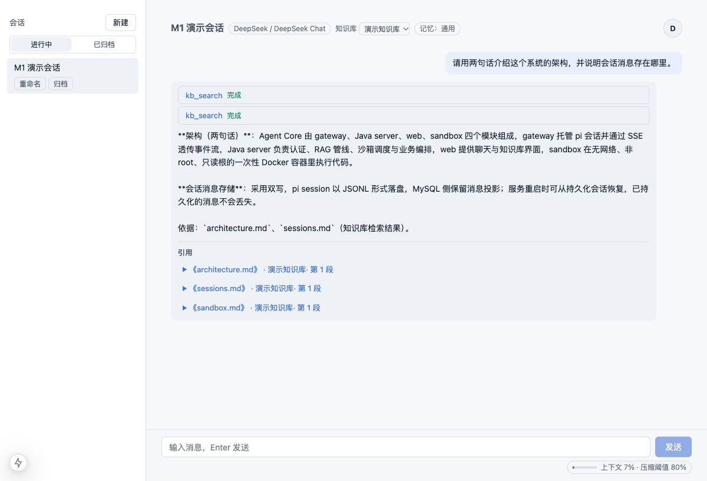

# agent-core

[](https://github.com/tofindhuang/agent-rag/actions/workflows/ci.yml)
[](https://nodejs.org/)
[](https://adoptium.net/)
[](#授权license)

> 一个可私有部署的**对话级知识库系统**：多轮流式对话、RAG 检索、沙箱代码执行、上下文自动压缩、用户长期记忆。

底层 agent 循环基于 [pi](https://github.com/earendil-works/pi-coding-agent)（SDK + extension，不 fork 源码），
业务编排、认证、检索与沙箱调度由 Java 服务承担。**Java 永远不直接调用 LLM，gateway 是唯一的模型通路。**



---

## 特性

| 能力 | 说明 | 状态 |
|---|---|---|
| 对话管理 | 会话 CRUD、多轮上下文、SSE 流式输出、中断、冷启动恢复 | ✅ M1 |
| 知识库 / RAG | 上传 → 解析 → 切分 → embedding → Qdrant；`kb_search` 工具 + 引用溯源；多知识库；扫描件 OCR | ✅ M1 |
| 沙箱代码执行 | 模型调用 `run_code`，一次性 Docker 容器：禁网、非 root、只读根、CPU/内存限制、审计入库 | ✅ M1 |
| 上下文压缩 | 接近模型窗口时自动 compaction，摘要可见、原文可回捞，上下文用量实时展示 | ✅ M1 |
| 长期记忆 | 会话结束后异步提取偏好/项目事实，冲突版本化；按会话选择记忆集注入 | ✅ M1 |
| 多租户与安全 | JWT（access + refresh）、会话按用户隔离、工具白名单、per-user RPM/TPM 限流 | ✅ M1 |
| 可观测 | Prometheus 指标（限流等）；用量统计、全链路 trace、运营看板 | 🚧 M2 |
| 多实例 | gateway 横向扩展、会话亲和路由、滚动更新不断流 | 🚧 M2 |

M1 的验收证据（50 并发压测、重启耐久性、延迟指标）见
[docs/research/2026-10-25-m1-load-test-report.md](docs/research/2026-10-25-m1-load-test-report.md) 与
[docs/tickets/m1-closeout/01-closeout-record.md](docs/tickets/m1-closeout/01-closeout-record.md)。

## 架构

```text
                    ┌─────────────────────────────┐
  Browser ────────▶ │  web (Next.js, :3000)        │
                    └──────────────┬──────────────┘
                                   │ HTTP + SSE
                    ┌──────────────▼──────────────┐
                    │  server (Java 21, :8080)     │  认证 / RAG / 沙箱调度 / 画像 / 编排
                    └───┬───────────┬───────────┬─┘
                        │           │           │
              ┌─────────▼──┐  ┌─────▼─────┐  ┌──▼─────────────────┐
              │  gateway    │  │  sandbox  │  │ MySQL / Redis /     │
              │  (pi, :3001)│  │ (one-shot)│  │ Qdrant / RabbitMQ / │
              └─────┬───────┘  └───────────┘  │ S3 (Silo)           │
                    │                         └─────────────────────┘
                    ▼
             Model Provider（OpenAI 兼容 / Anthropic）
```

职责边界：

- **web**：只做界面与 SSE 渲染，不承载业务逻辑。
- **server**：业务状态机；对 gateway 的调用集中在 service 层。
- **gateway**：托管 pi `AgentSession`，注册 `kb_search` / `run_code` 工具，负责模型流与工具进度。
- **sandbox**：一次性容器执行代码，结束即销毁。

## 目录结构

```text
├── gateway/       Node 22 + TypeScript：pi 会话托管、SSE 契约、工具扩展
├── server/        Java 21 + Spring Boot 3：认证、RAG、沙箱、画像、业务编排
├── web/           Next.js 15：聊天、知识库、记忆与设置界面
├── sandbox/       沙箱执行镜像（Python 3.12，隔离参数见 Dockerfile.python）
├── ocr/           RapidOCR 侧车（可选，扫描版 PDF 兜底）
├── contract/      Java ↔ gateway 契约 v1（事件 schema、错误码、复用 fixture）
├── tools/loadtest/ 并发压测与验收 harness
├── docs/          需求、specs、tickets、ADR、研究记录
├── CONTEXT.md     领域词汇表
└── docker-compose.yml  本地基础设施（MySQL/Redis/Qdrant/RabbitMQ/Silo，OCR 可选）
```

## 快速开始

### 前置依赖

| 依赖 | 版本 | 用途 |
|---|---|---|
| Node.js | **22+** | gateway（pi SDK 需要 `fs.globSync`）与 web |
| JDK | **21+** | server |
| Maven | 3.9+ | server 构建 |
| Docker | 24+（Compose v2） | 基础设施、沙箱、集成测试 |
| Python | 3.12（可选） | 仅 OCR 侧车 |

### 1. 配置环境变量

```bash
cp .env.example .env
```

生产/共享环境务必替换以下两个值（`.env` 已被 gitignore，**不要提交密钥**）：

```bash
# 32 字节随机数（Base64），用于加密用户填写的模型 API key（AES-GCM）
openssl rand -base64 32        # → MODEL_SECRET_KEY

# ≥32 字节的 HS256 签名密钥
openssl rand -hex 32           # → JWT_SECRET
```

启动 server / gateway 的终端需要加载这些变量（Spring Boot 与 Node 都不会自动读取 `.env`）：

```bash
set -a; . ./.env; set +a
```

### 2. 启动基础设施

```bash
docker compose up -d --wait
```

| 服务 | 端口 | 说明 |
|---|---|---|
| MySQL 8.4 | 3306 | 业务库（Flyway 启动时自动迁移） |
| Redis 7 | 6379 | 会话路由、限流、沙箱许可 |
| Qdrant | 6333 | 知识库向量 |
| RabbitMQ | 5672 / 15672 | KB 摄取队列（管理台 15672） |
| Silo | 9000 / 9001 | S3 兼容原文存储（MinIO 兼容） |
| OCR（可选） | 8000 | `docker compose --profile ocr up -d` |

### 3. 构建沙箱镜像（使用 `run_code` 前必须）

服务运行时**不构建、不拉取**镜像：

```bash
docker build -t agent-core-sandbox:python-3.12 -f sandbox/Dockerfile.python sandbox
```

### 4. 启动 Java 业务层

```bash
cd server
mvn spring-boot:run
# 健康检查：curl http://localhost:8080/api/health
# 管理端口（仅 Prometheus）：http://localhost:9091/actuator/prometheus
```

首次启动会由 Flyway 自动执行全部 up-only 迁移。

### 5. 启动 gateway

```bash
cd gateway
npm ci
npm run dev        # tsx watch，监听 :3001
# 健康检查：curl http://localhost:3001/health
```

### 6. 启动 web

```bash
cd web
npm ci
npm run dev        # Next.js，监听 :3000
```

打开 **http://localhost:3000**，注册账号后按下一步配置模型。

### 7. 首次使用

1. **配置模型**：设置 → 模型服务 → 新增供应商（OpenAI 兼容或 Anthropic Messages），填写 Base URL、模型 ID、API Key，并设为默认。API Key 加密入库（ADR-0010），仅在该用户会话中使用。
2. **（可选）配置知识库**：知识库 → 设置 → 配置 OpenAI 兼容的 embedding / rerank 端点（也可用部署级 `EMBEDDING_*` / `RERANK_*`），然后上传 PDF / Markdown / TXT / DOCX 或抓取 URL。
3. **建会话**：选择模型与知识库；勾选要注入的记忆集。
4. **长期记忆**：新事实默认进入「收件箱」，会话默认选「通用」——需要在新建会话或会话头部显式勾选「收件箱 / 场景集」才会注入。
5. **代码执行**：聊天中让模型调用 `run_code`（需第 3 步镜像）。

> 本地开发若没有真实 embedding 供应商，可以只使用纯对话；知识库上传会因 embedding 未配置而返回明确错误。
> `tools/loadtest/scripts/` 提供了带确定性假 embedding 的一次性栈，仅用于压测/验收。

## 配置

完整变量见 [.env.example](.env.example)。常用分组：

| 变量 | 默认 | 说明 |
|---|---|---|
| `JWT_SECRET` | 开发占位值 | 必填；长度 ≥32 字节，否则启动失败 |
| `MODEL_SECRET_KEY` | 开发占位值 | 必填；32 字节 Base64，加密用户 provider key |
| `GATEWAY_URL` / `GATEWAY_API_TOKEN` | `http://localhost:3001` / 空 | Java → gateway；生产建议设置共享 token |
| `MYSQL_*` / `REDIS_*` | 见 `.env.example` | 基础设施连接 |
| `EMBEDDING_*` / `RERANK_*` | 空 | KB 部署级兜底（用户级设置优先） |
| `KB_ALLOW_PRIVATE_ENDPOINTS` | `false` | 是否允许内网 embedding / 模型端点 |
| `RATE_LIMIT_USER_RPM` / `USER_TPM` / `AUTH_IP_RPM` | 120 / 100000 / 10 | FR-6 固定窗口限流 |
| `COMPACTION_*` | 见 gateway | 压缩开关与保留预算 |
| `PROFILE_MAX_FACTS` / `PROFILE_MAX_CHARS` | 20 / 4000 | 画像注入预算（已实测，见 ADR-0020） |
| `NEXT_PUBLIC_API_BASE` | `http://localhost:8080` | web 访问后端地址 |
| `AUTH_COOKIE_SECURE` | `false` | 生产 HTTPS 下必须为 `true` |

## 测试与质量门

```bash
# gateway（类型检查 + 单测）
cd gateway && npm ci && npm run typecheck && npm test

# server（集成测试使用 Testcontainers，需要 Docker；先构建沙箱镜像）
docker build -t agent-core-sandbox:python-3.12 -f sandbox/Dockerfile.python sandbox
cd server && mvn -B verify

# web
cd web && npm ci && npm run typecheck && npm run build

# OCR（可选）
cd ocr && pip install -r requirements-dev.txt && pytest

# 压测 harness
cd tools/loadtest && npm ci && npm test
```

CI（`.github/workflows/ci.yml`）覆盖 contract / gateway / server / web / ocr / sandbox 六个 job。

## 可选组件

### OCR 侧车（扫描版 PDF）

```bash
docker compose --profile ocr up -d ocr
```

然后在 server 环境中启用：

```bash
export KB_OCR_ENABLED=true
export KB_OCR_BASE_URL=http://localhost:8000
export KB_OCR_TOKEN=<可选共享 token>
```

### 沙箱隔离验证

```bash
bash sandbox/test-isolation.sh
```

### 压测 / M1 验收

`tools/loadtest` 可一键起一次性栈并跑 50 并发、工具路径、重启耐久性验证；
用法与报告见 [tools/loadtest/README.md](tools/loadtest/README.md) 与
[docs/research/2026-10-25-m1-load-test-report.md](docs/research/2026-10-25-m1-load-test-report.md)。

## 文档

| 内容 | 位置 |
|---|---|
| 需求（唯一权威） | [docs/requirements.md](docs/requirements.md) |
| 领域词汇表 | [CONTEXT.md](CONTEXT.md) |
| 跨模块 specs | [docs/specs/](docs/specs/) |
| ADR | [docs/adrs/](docs/adrs/) |
| 工单与验收记录 | [docs/tickets/](docs/tickets/) |
| 研究与压测报告 | [docs/research/](docs/research/) |
| Java ↔ gateway 契约 | [contract/v1/README.md](contract/v1/README.md) |
| 开发规范（模块地图/编码/流程） | [AGENTS.md](AGENTS.md) |

## 路线图

- **M1（已完成）**：P0 全量 —— 认证与多租户、RAG 摄取、沙箱隔离与审计、compaction、长期记忆、限流；50 并发验收通过。
- **M2（进行中/计划）**：
  - gateway 多实例、会话 hash 亲和路由、滚动更新不断流；
  - FR-7 可观测：用量统计、`request_id` 全链路 trace、运营看板；
  - 沙箱预热池/容器复用评估、gVisor 评估；
  - OAuth 登录（P1）、限流调优。

## 参与贡献

- 开发在 `dev` 分支进行，完成后以 PR 合并回 `main`。
- 提交信息遵循 `{feat,fix,docs,chore,refactor,test}(scope): message`。
- 新功能 / 架构组件 / schema 变更 / 外部集成走 spec → tickets → TDD → review 流程，详见 [AGENTS.md](AGENTS.md)。
- 数据库迁移 **up-only**：只新增 `YYYYMMDDHHMMSS__slug.up.sql`，不要提交 `*.down.sql`。
- 不要提交任何密钥、`.env`、模型凭证或本地数据；PR 前跑对应模块的 typecheck / 测试。

## 安全

- 模型 API Key 由用户在应用内填写，使用 AES-GCM 加密后入库；不会写入日志或仓库。
- 生产部署请启用 TLS，并设置 `AUTH_COOKIE_SECURE=true`；替换所有默认口令与密钥。
- 沙箱不是绝对安全边界：已禁网、非 root、只读根、资源受限，但仍建议在专用主机运行并关注上游 gVisor 方案。
- 发现安全问题请通过仓库维护者的私密渠道报告，不要在公开 Issue 中披露细节。

## 授权（License）

本项目采用**源码可见（source-available）**授权，**不是** OSI 认可的开源许可证：

- **允许**：个人学习、研究、评估、非商业性质的内部使用；修改源码并自用部署。
- **需要书面授权**：任何商业用途，包括对外提供 SaaS/托管服务、嵌入商业产品、以本项目为基础收费分发。
- **再分发**：须保留版权声明与本授权条款；不得使用项目名称、Logo 或维护者名义暗示官方背书。
- **第三方组件**：pi SDK 及其他依赖遵循其各自许可证，本授权不改变这些条款。
- **无担保**：软件按「现状」提供，不附带任何明示或暗示担保。

商业授权与合作请联系仓库维护者。完整条款见 [LICENSE](LICENSE)；本项目不是 OSI 认可的开源许可证。
